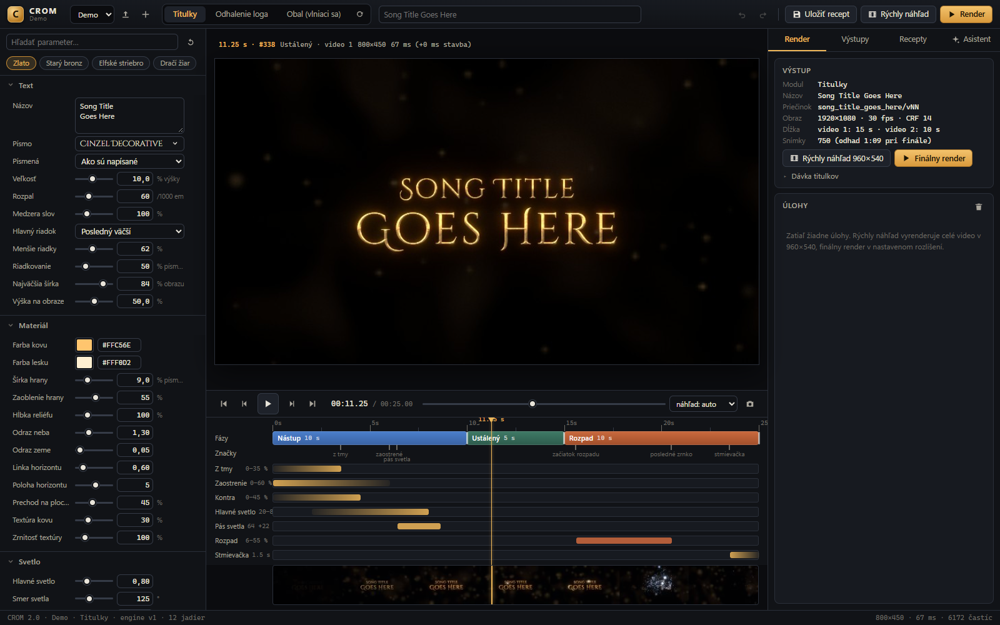
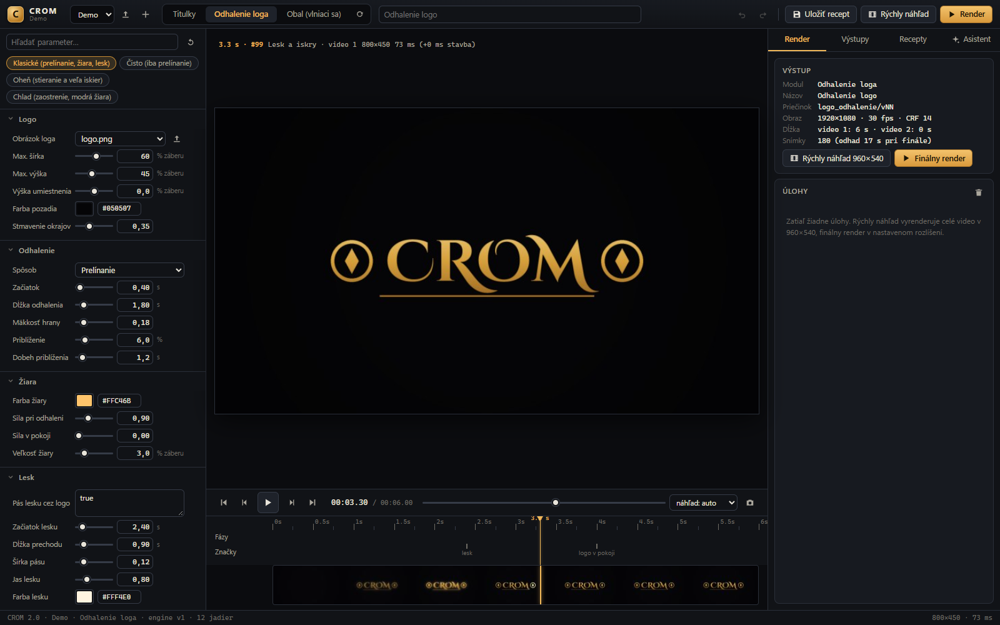
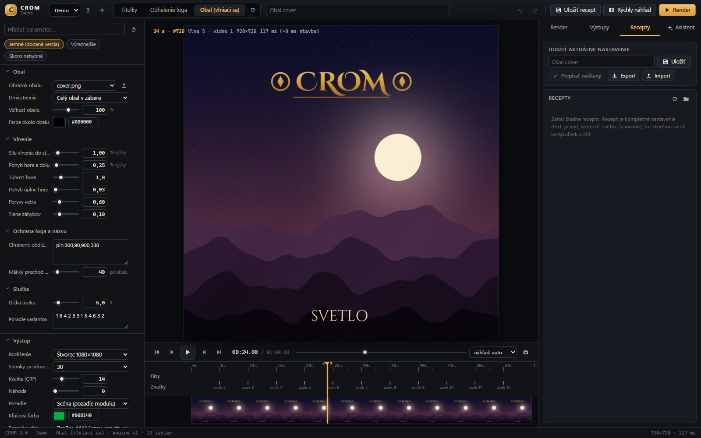
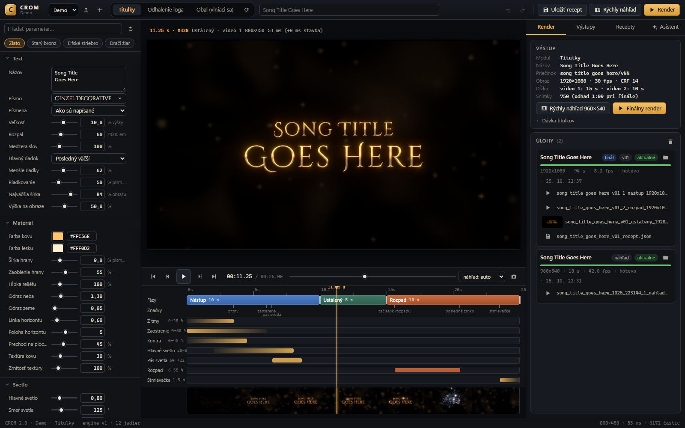
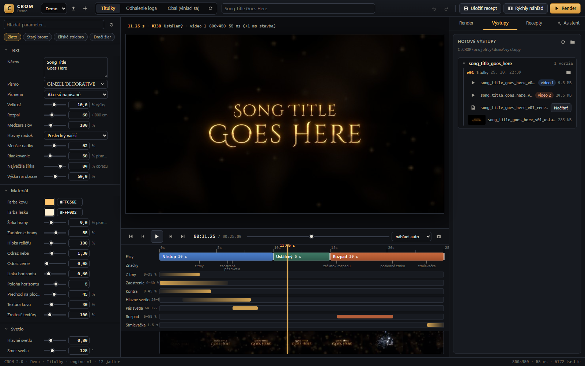

# CROM band visuals

CROM is a small local app for making concert and music-video visuals for a band:

- **Song titles**: animated song and album names, with presets like gold, old bronze, elven silver and dragon glow.
- **Logo reveal**: any PNG logo appears with a glow, a shine sweep and sparks. When the effects settle, the logo is the original image pixel for pixel. It is never redrawn or resampled.
- **Waving album cover**: the cover moves like cloth in the wind, with optional areas pinned still so the band name stays readable.

Everything renders on your own computer. Nothing is uploaded. Every module can export with a transparent background:

| Format | Use it for |
|---|---|
| ProRes 4444 (.mov) | Premiere, DaVinci Resolve, Final Cut |
| HAP Alpha (.mov) | Resolume and other VJ software |
| WebM VP9 (.webm) | web |
| PNG sequence | anything else |

The interface is in Slovak. This README gives the English name of each control next to its Slovak label. A Slovak user guide is in [NAVOD.md](NAVOD.md).

## Run it on localhost

You need Python 3.10 or newer and ffmpeg. The app serves a web page at **http://localhost:8765** and listens on your own machine only (127.0.0.1).

### Windows 10 / 11

1. Download the repo (**Code > Download ZIP**) and unzip it, or `git clone https://github.com/BranLang/crom-band-visuals.git`.
2. Double-click **`instaluj.bat`** (install, needed once). If Python or ffmpeg is missing, it installs them with winget. Then it creates `.venv` and installs the Python packages.
3. Double-click **`spusti.bat`** (start). Your browser opens http://localhost:8765. Keep the black window open while you work. Closing it stops the app.

Manual install from a terminal in the repo folder:

```bat
winget install -e --id Python.Python.3.12
winget install -e --id Gyan.FFmpeg
python -m venv .venv
.venv\Scripts\python -m pip install -r requirements.txt
.venv\Scripts\python app.py --open
```

### macOS

Install Python and ffmpeg with [Homebrew](https://brew.sh), then run the two scripts from a terminal in the repo folder:

```bash
brew install python ffmpeg
./install.sh
./start.sh
```

`install.sh` creates `.venv` and installs the packages. `start.sh` starts the app and opens http://localhost:8765. Press Ctrl+C in the terminal to stop it.

Manual alternative:

```bash
python3 -m venv .venv
.venv/bin/pip install -r requirements.txt
.venv/bin/python app.py --open
```

> The app is tested on Windows 11. The macOS scripts are new and have not been tested on a real Mac yet. Please open an issue if something fails.

### Other options

```text
python app.py --port 8800    # different port, if 8765 is taken
python app.py --open         # also open the browser
```

## How to use it

The repo ships with a **Demo** project: a made-up CROM logo and an album cover called *SVETLO*. Try everything on it first, then add your own band.

### 1. Pick a project and a module

The project picker is at the top left. Under it are the three modules: **Titulky** (song titles), **Odhalenie loga** (logo reveal) and **Obal (vlniaci sa)** (waving cover). The large preview in the middle updates as soon as you change something.



- **Predvoľby** (presets) set the whole look at once. Fine-tune it with the sliders on the right: timing, colours, light, camera.
- The **timeline** under the preview shows the phases of the animation: *Nástup* (in), *Ustálený* (hold) and *Rozpad* (out). Click on it to jump to any moment.
- The camera icon under the preview saves the current frame as a PNG.

### 2. Logo reveal

Pick your logo in the **logo** field. A PNG with a transparent background works best. Choose how it appears (fade, wipe, focus or slide up), then add glow, shine and sparks to taste.



### 3. Waving album cover

Pick the cover in the **obal** field. The filmstrip shows frames across the whole clip, so you can see the motion without playing it. Pinned boxes keep parts of the cover (the band name, for example) still while the rest waves.



### 4. Transparent background

In the **Výstup** (output) group, set the background to **Priehľadné (alfa kanál)** (transparent, alpha channel) and pick one of the formats from the table above. A video like that sits on top of anything in your editor or VJ software.

### 5. Preview and render

- **Rýchly náhľad** (quick preview) renders a 960×540 video in seconds into `projekty/<project>/vystupy/_nahlady`. With alpha it is always WebM.
- **Render** makes the final video at full resolution into `projekty/<project>/vystupy/<name>/vNN`. Every render gets a new version folder (`v01`, `v02`, …), so nothing is overwritten. On a typical PC a 30 s Full HD clip takes about one and a half minutes.
- The **Úlohy** (jobs) panel shows running and finished renders.



### 6. Outputs and recipes

The **Výstupy** (outputs) tab lists the finished videos of the project. The folder icon opens them in Explorer or Finder.



**Uložiť recept** (save recipe, Ctrl+S) stores every setting of the current module. Load it again from the **Recepty** (recipes) tab. Each final render also saves its recipe next to the video, so you can always rebuild it.

### 7. Your own band

- Click **+** next to the project picker (new project) and type the band name. Each project has its own logos, covers, recipes and outputs.
- The upload icon next to the picker (**Logo a obaly projektu**, project logos and covers) opens a window where **Nahrať…** (upload) adds a logo or a cover.

A project is a plain folder:

```text
projekty/
  my-band/
    projekt.json     name and description
    logo/            logos (PNG with transparency)
    obaly/           album covers
    recepty/         saved recipes
    vystupy/         renders (ignored by git)
```

## Optional: control it from Claude (MCP)

CROM includes an MCP server (`mcp_server.py`), so Claude Desktop or Claude Code can drive it in plain words. Claude can create a project, add a logo, set the parameters, look at preview frames and render.

- Windows: run `instaluj.bat` first, then double-click **`pripoj_claude.bat`**. It asks whether to add CROM to Claude Code and to Claude Desktop, and backs up your Claude Desktop config first.
- macOS: `.venv/bin/python mcp_server.py --setup`

Restart Claude Desktop afterwards. Claude starts CROM by itself when it needs it. Example prompts:

- "In CROM, make titles for the song *Golden Dragon* from the album *Svetlo*, dark with fire, and show me the frame at 3 s."
- "Create a project for the band XY, add the logo `~/Desktop/logo.png` and make a logo reveal with a transparent background."
- "Render the waving cover, 10 seconds, Full HD."

## Optional: AI assistant in the app (paid)

The **Asistent** tab turns a sentence into settings, for example "slow gold titles that burn out at the end". It calls the Anthropic API. **Every use is billed to your own Anthropic account.** Without a key the rest of the app works the same.

1. Install the SDK: `.venv\Scripts\python -m pip install anthropic` (Windows) or `.venv/bin/pip install anthropic` (macOS).
2. Paste your key in the **Asistent** tab under the key icon and click **Uložiť kľúč** (save key). You can set `ANTHROPIC_API_KEY` instead.
3. **Overiť kľúč** (check key) is free.

The key is stored only in `_nastavenia.json` in the app folder. That file is in `.gitignore`, so it never gets committed.

| Model | Input / output per million tokens |
|---|---|
| Claude Opus 5.5 (default) | $4 / $20 |
| Claude Sonnet 5.5 | $2 / $10 |
| Claude Haiku 5.5 | $0.10 / $0.50 |

When the assistant looks at preview frames, each 960×540 frame costs about 690 input tokens.

## Troubleshooting

- **Port 8765 is already in use**: another copy of CROM is probably running. Close it, or start with `--port 8800`.
- **ffmpeg not found**: install it (`winget install -e --id Gyan.FFmpeg` or `brew install ffmpeg`), then open a new terminal so the PATH refreshes.
- **macOS says the script is not executable**: `chmod +x install.sh start.sh`.
- **Something else**: open an issue with the error text from the terminal window.

## Fonts

The fonts in `fonts/` (Cinzel, Cinzel Decorative, EB Garamond, IM Fell English) are under the SIL Open Font License, see [fonts/OFL.txt](fonts/OFL.txt).
